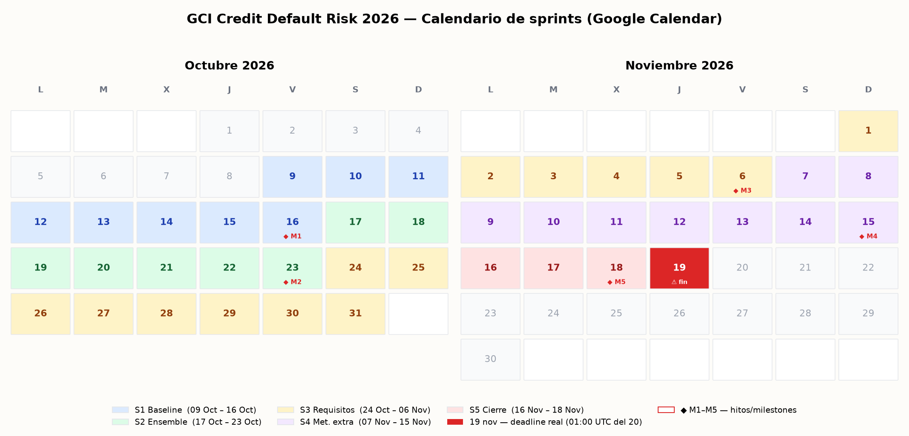

# GCI Credit Default Risk 2026 — Planificación pública

Repositorio de **gestión y documentación** del proyecto para la competencia
**GCI Global 2026 · Home Credit Default Risk** (subset de una tabla, métrica ROC-AUC,
cierre 2026-11-20 01:00 UTC).

> El **código y los experimentos** viven en el repo hermano:
> [`mariomarroquin3/gci_home_credit`](https://github.com/mariomarroquin3/gci_home_credit)

## Contenido

| Ruta | Qué es |
|---|---|
| [`DECISIONES.md`](DECISIONES.md) | Registro de decisiones del proyecto (quién, cuándo, por qué) |
| [`docs/LINEAR_SETUP.md`](docs/LINEAR_SETUP.md) | Configuración completa del proyecto en Linear: milestones, sprints y las 18 issues con criterios de aceptación |
| [`docs/calendar_sprints.png`](docs/calendar_sprints.png) | Calendario de sprints e hitos (render de Google Calendar) |
| [`slides/GCI_modelos_y_preprocesamiento.pptx`](slides/GCI_modelos_y_preprocesamiento.pptx) | Presentación: modelos a utilizar, preprocesamiento requerido y sugerido, con visualizaciones de datos reales |
| [`latex/GCI_modelos.tex`](latex/GCI_modelos.tex) | Documento LaTeX con los modelos y las matemáticas auditables del pipeline |

## Sprints e hitos (resumen)

| Sprint | Fechas | Hito |
|---|---|---|
| S1 · Baseline | 9 – 16 oct | **M1 (16 oct):** baseline submission en LB |
| S2 · Ensemble | 17 – 23 oct | **M2 (23 oct):** ensemble base LGBM/XGB/CatBoost |
| S3 · Requisitos mínimos | 24 oct – 6 nov | **M3 (6 nov):** mínimos completos (red de seguridad) |
| S4 · Métodos extra | 7 – 15 nov | **M4 (15 nov):** métodos extra terminados |
| S5 · Cierre | 16 – 18 nov | **M5 (18 nov):** submission final congelada |
| — | **19 nov** | ⚠️ Deadline real (01:00 UTC del 20 nov) |

Las **issues** de este repo (pestaña Issues) replican el plan operativo con sus milestones.

## Reglas de la competencia (recordatorio)
- Métrica AUC-ROC; submission CSV `SK_ID_CURR,TARGET`; formato incorrecto = score −1.
- **Solo cuenta la última submission** para el ranking final.
- Sin datos externos, sin hand-labeling. Código reproducible (seeds fijas) y citas obligatorias.

---
Autor: Mario Marroquín · Asistente de planificación: [Fluso](https://fluso.ai)
